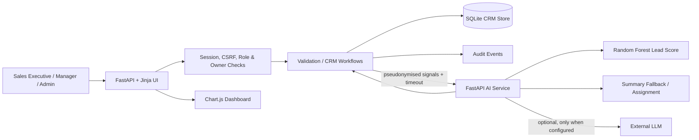

# Architecture

## Data path

1. A user signs in; the web service validates the password hash and creates a signed session.
2. Every CRM page and protected API checks the user's role and record scope on the server.
3. CRM mutations validate required fields, formats, ownership and business rules before the database commit.
4. Mutations create an audit event. Customer contact fields are excluded from audit snapshots.
5. Lead changes request scoring from the AI service. If the service is unavailable, the web app computes a transparent fallback score.
6. Hover summaries use `Account {id}` aliases and compact numeric/status facts. The output is cached in memory for ten minutes.
